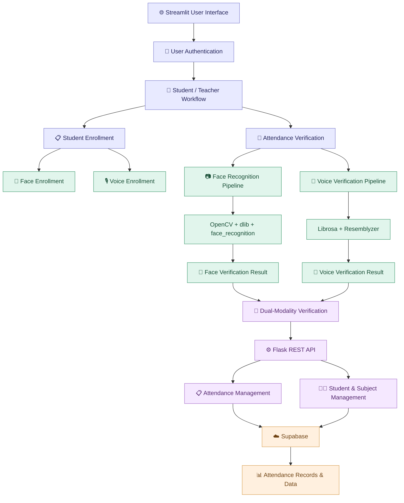

# 🤖 AI-Powered Attendance System

### Smart Biometric Attendance Using Face Recognition & Voice Verification

An intelligent attendance management system that combines **facial recognition and voice verification** to provide dual-modality biometric authentication, automate attendance recording, and reduce proxy attendance.

  <a href="https://smartclass-three.vercel.app/"><strong>🌐 Live Demo</strong></a>
  &nbsp; • &nbsp;
  <a href="https://github.com/Sanskriti199/SmartClass-Frontend"><strong>🎨 Frontend Repository</strong></a>

---

## 🌐 Live Application

| Resource | Link |
|---|---|
| Live Application | [SmartClass AI Attendance](https://smartclass-three.vercel.app/) |
| Frontend Repository | [SmartClass-Frontend](https://github.com/Sanskriti199/SmartClass-Frontend) |

> The deployed interface is the frontend of the SmartClass AI Attendance System.

## 📌 About the Project

The **AI-Powered Attendance System** is a biometric attendance management platform designed to make classroom attendance more secure, intelligent, and automated.

Unlike traditional attendance systems, it combines two biometric authentication methods:

- **Face Recognition:** Identifies registered students using facial features.
- **Voice Verification:** Verifies students through voice-based speaker recognition.

The system integrates an interactive Streamlit application, a Flask REST API backend, dedicated face and voice processing pipelines, and Supabase for cloud-based data management.

By combining these technologies, the application provides a dual-modality identity verification workflow before recording attendance.

## ✨ Key Features

| Feature | Description |
|---|---|
| 👤 Face Recognition | Detects and recognizes registered students using facial recognition models |
| 🎙️ Voice Verification | Performs speaker verification using voice embeddings |
| 🔐 Dual-Modality Authentication | Combines face and voice verification for identity validation |
| 📋 Automated Attendance | Records attendance after successful authentication |
| 👨‍🎓 Student Enrollment | Supports student registration and biometric enrollment |
| 👨‍🏫 Teacher Dashboard | Enables teachers to manage subjects, students, and attendance records |
| 🗄️ Cloud Database | Uses Supabase for student and attendance data management |
| 🎨 Interactive UI | Provides a Streamlit-based interface for students and teachers |
| 🔗 REST API Backend | Uses Flask APIs to handle backend application services |

## 🧠 Biometric Authentication

### 1. Face Recognition

The face recognition pipeline uses computer vision and facial recognition libraries to identify registered students.

**Technologies:** OpenCV, dlib, face_recognition, face_recognition_models.

### 2. Voice Verification

The voice verification pipeline processes audio input and uses speaker embeddings to verify a student's voice.

**Technologies:** Librosa, Resemblyzer.

### 3. Dual-Modality Verification

Both biometric pipelines contribute to identity validation, adding another layer of authentication beyond conventional attendance methods.

## 🛠️ Tech Stack

| Category | Technologies |
|---|---|
| Programming Language | Python |
| Frontend | Streamlit, HTML, CSS |
| Backend | Flask, REST API |
| Computer Vision | OpenCV, dlib |
| Face Recognition | face_recognition, face_recognition_models |
| Voice Processing | Resemblyzer, Librosa |
| Machine Learning | Scikit-learn |
| Data Processing | NumPy, Pandas |
| Database | Supabase |
| Security | bcrypt |
| Image Processing | Pillow |
| QR Code Generation | Segno |
| Package Management | Setuptools |

## 📦 Main Dependencies

| Dependency | Purpose |
|---|---|
| `streamlit` | Interactive application interface |
| `flask` | REST API backend |
| `opencv-python` | Image processing and computer vision |
| `dlib-bin` | Facial landmark and face processing |
| `face_recognition` | Face detection and recognition |
| `face_recognition_models` | Pre-trained face recognition models |
| `resemblyzer` | Speaker embeddings and voice verification |
| `librosa` | Audio processing and feature extraction |
| `scikit-learn` | Machine learning utilities |
| `numpy` | Numerical computation |
| `pandas` | Data manipulation and processing |
| `supabase` | Cloud database integration |
| `bcrypt` | Password hashing |
| `pillow` | Image processing |
| `segno` | QR code generation |
| `setuptools` | Python package management |

---

## 🏗️ System Architecture

The application follows a modular architecture in which the frontend communicates with backend services and two independent biometric processing pipelines. The verification results are handled by the Flask REST API, while Supabase manages the application's cloud data.

### Architecture Components

| Component | Responsibility |
|---|---|
| Streamlit UI | Provides the interactive application interface |
| Authentication | Handles user access and authentication workflows |
| Face Recognition Pipeline | Processes facial input and recognizes registered students |
| Voice Verification Pipeline | Processes audio and verifies speaker identity |
| Dual-Modality Verification | Combines the face and voice verification results |
| Flask REST API | Handles backend services and application communication |
| Attendance Management | Processes and records attendance information |
| Supabase | Provides cloud-based storage and data management |

### End-to-End Workflow

1. **User Access:** Students and teachers interact with the application through the Streamlit interface.
2. **Student Enrollment:** Student information and biometric data are registered.
3. **Face Processing:** The face recognition pipeline processes facial input using OpenCV, dlib, and face recognition models.
4. **Voice Processing:** The voice pipeline processes audio using Librosa and Resemblyzer.
5. **Identity Verification:** The system combines the face and voice verification results.
6. **Backend Processing:** Flask REST APIs handle the application's backend operations.
7. **Attendance Recording:** Attendance is recorded following successful authentication.
8. **Cloud Storage:** Supabase manages student, subject, and attendance-related information.

---

## ☁️ Deployment & Infrastructure

The project uses cloud services to make the application accessible and support its backend data management.

| Platform | Purpose |
|---|---|
| **Streamlit Cloud** | Deployment of the Streamlit application |
| **Vercel** | Hosting of the web frontend |
| **Supabase** | Cloud database and data management |

## 💡 What Makes This Project Interesting?

- Combines two biometric modalities instead of relying on a single authentication method.
- Integrates computer vision with speaker verification.
- Connects independent face and voice processing pipelines through a Flask REST API.
- Demonstrates practical applications of AI and machine learning in educational environments.
- Integrates cloud database management with an interactive application interface.
- Automates attendance workflows while aiming to reduce proxy attendance.

## 🔮 Future Enhancements

- Improve biometric verification robustness under different environmental conditions.
- Introduce advanced attendance analytics and reporting.
- Expand support for additional biometric authentication methods.
- Enhance student performance and attendance visualization.
- Improve scalability for larger classroom environments.

---

  <strong>SmartClass — Making Classroom Attendance Smarter with AI.</strong>

